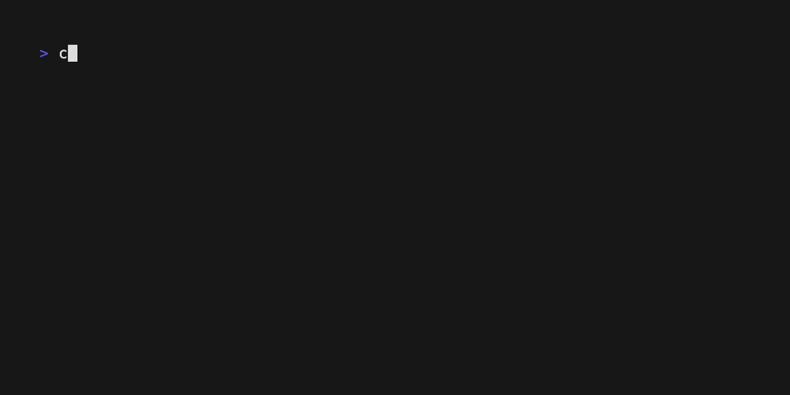
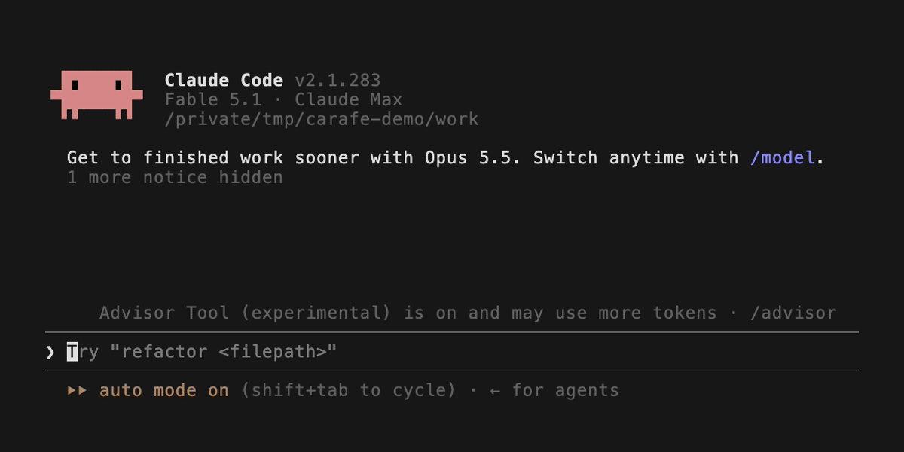

# Carafe

Carafe keeps your AI coding sessions available on your own machine.
Find past work, replay its history, and hand off a session from Claude Code or Codex
to any agent that can read a file: Claude Code, Codex, Cursor, Devin, and the rest.
Use the CLI, a local browser UI, or the macOS menu bar app.

## Command line



Everything carafe does, in the menu bar app and the agent skill too, is a `carafe` command. The ones you will use:

| Command | What it does |
| --- | --- |
| `carafe list` | Recent sessions across tools, newest first (`--tool codex`, `--interactive` to hide agent-spawned ones) |
| `carafe search "<terms>"` | Ranked recall across every captured session; `--session <id>` searches inside one |
| `carafe show <id> --seq A-B` | Print a section of a session's trace verbatim |
| `carafe key-moments <id>` | The decisions, dead ends and breakthroughs of a session, with a copyable resume block |
| `carafe ask <id> --file F` / `--failed` | Which chapters touched a file, what failed, which commands ran |
| `carafe handoff <id\|latest\|current>` | Write a self-contained Markdown handoff and print the line to paste into the next agent |
| `carafe handoff current --questions` | The seven questions the outgoing agent answers first, and where to save them |
| `carafe ui` | The local browser UI: search, sessions, replay, hand off |
| `carafe checkpoint <id>` / `carafe undo <id> --to-seq N` | Snapshot a worktree, or restore files to an earlier point (plan first, `--apply` to do it) |
| `carafe service status` | Is background capture running, and which build runs it |
| `carafe skills install` | Install the Claude Code skill and the Codex prompt (below) |
| `carafe update` | Update the CLI from the release feed, checksums verified |

`carafe --help` lists everything, including the live multiplexer (`carafe start`),
the benchmarks and the maintenance commands. Every command reads the store; the
only ones that change anything are `import`/`watch` (capture), `checkpoint`,
`undo --apply`, `gc`, `skills`, `reflex install` and `update`.

## 60-second quickstart

Install the standalone binary (macOS or Linux; no Node or Bun required):

```sh
curl -fsSL https://raw.githubusercontent.com/Carafehq/carafe/main/install.sh | sh
export PATH="$HOME/.local/bin:$PATH"
carafe list
carafe ui
```

Run a session in a supported tool first if your list is empty. Installation starts
local background capture; use `--no-watcher` to opt out, or `carafe service disable`
to stop it. `carafe --help` lists the commands. Git is needed for checkpoints and undo.

No token or GitHub account is needed. Releases and source are public.

The installer verifies release checksums and installs to `~/.local/bin` (override
with `--dir`). macOS and Linux, x64 and arm64 are supported, including Linux musl
and x64 baseline builds. There is no Windows binary.

## macOS app


Download `Carafe-VERSION.zip` from
[Releases](https://github.com/Carafehq/carafe/releases), extract it, and open
Carafe. The app offers session handoffs, capture status, and prompt reflex controls.
It is signed with a Developer ID and notarized by Apple, so it opens like any other
app. See [app documentation](apps/menubar/README.md).

## Supported tools

Handoffs **come from** the tools carafe records, and **go to** any agent:

| Tool | Session capture | Search and replay | Hand off from it |
| --- | --- | --- | --- |
| Claude Code | Yes | Yes | Yes |
| Codex | Yes | Yes | Yes |

**Receiving a handoff needs nothing from carafe.** A handoff is a self-contained Markdown
file, so any agent that can read a file picks it up: Claude Code, Codex, Cursor,
Windsurf, Devin, Gemini CLI, or a chat window you attach it to. Paste the copied
`Read <path> and continue the work` and the agent has the context.

Carafe reads the structured session files these tools already write. Source
session files are never modified. Prompt reflex hooks are optional; enable them
with `carafe reflex install` and follow its tool-specific trust instructions.

## Privacy

Carafe is local-first. It never uploads your session data. Capture, indexing,
search, replay, and handoff files stay on your machine under `~/.carafe`.
Secret-shaped text is redacted at egress, and a failed egress check blocks output.
A share file is an explicit export: writing one does not upload it; you decide
whether to send it. Sharing is part of Pro. Agent handoffs provide context to the
agent you launch, whose own network and privacy settings apply.

Installation and update checks contact GitHub for release metadata and binaries;
these requests contain no session content. Disable the daily background release
check with `CARAFE_NO_UPDATE_CHECK=1`. Explicit updates still contact the release
feed. Project health checks run only with explicit consent for that project.

## Find, replay, and hand off

`carafe list` lists captured sessions; `carafe search <query>` finds past work.
`carafe ui` opens the local switcher and replay view. To hand off, use **Hand Off →
From Claude Code / From Codex → session** in the menu bar, or run `carafe handoff <session-id>`.
The result is a self-contained Markdown file; paste the copied
`Read <path> and continue the work` into any agent that can read files (Claude Code,
Codex, Cursor, Devin, …). Handoffs are deterministic and secret-redacted,
with source references instead of LLM summaries.

`carafe start claude --prompt "Investigate the failing tests"` starts a managed
terminal session. `Ctrl-G` switches between live children; `Ctrl-H` hands context
to the other agent while keeping the original process alive; `Ctrl-Q` exits the
parent and its owned terminals. `Ctrl-M` shows the session map on terminals that
report enhanced CSI-u keys. Inspect saved maps with `carafe map`.

The default handoff storage is memory. Above 256 KiB, a child's transcript moves
to authenticated encrypted disk storage with a visible warning. The encryption
key lives only in the parent and managed children; these archives become
unreadable after all of them exit. `--handoff-storage disk` selects disk storage
up front. Capture pauses and handoff is refused if storage fails.

## The Claude Code and Codex skill

`carafe skills install` gives your agents the same memory you have. It writes a
`/carafe` skill for Claude Code (`~/.claude/skills/carafe/`) and a `/carafe`
prompt for Codex (`~/.codex/prompts/carafe.md`); `carafe skills status` shows what
is installed, `carafe skills uninstall` removes both.

With it installed, an agent answers questions like these from the store instead
of guessing:

- "What did we decide about the retry queue last week?" → `carafe search`, then
  `carafe show` for the exact turn.
- "Pick up where the other session left off." → `carafe key-moments latest`.
- "Hand this off." → the agent answers the seven handoff questions, saves them,
  then runs `carafe handoff current`. The handoff then carries what the agent
  knew *and* a machine-checked picture of the repositories right now.

Typing `/carafe <command>` runs that command verbatim, so `/carafe list --tool
codex` is exactly `carafe list --tool codex`. The skill only ever reads the store;
it never pushes, deletes or deploys. After `carafe update`, run
`carafe skills install` again to refresh the skill text.



## Updates and releases

`carafe update` checks the release feed, verifies checksums, and replaces the CLI
atomically. `carafe update --check` reports only (exit 2 means an update exists).
The app's Check for Updates opens its releases page. A service is restarted only
when it runs the updated binary. Re-running the installer does not replace a
working installation unless `--force` is passed.

Public version numbering starts at **0.1.0**. Stable tags are `vX.Y.Z`; pushes to
`main` build `vX.Y.Z-alpha.<short-sha>` releases. Source builds use the package's
public version. Download a platform tarball from Releases for offline installation.

## Open source

Carafe's open build is licensed under Apache-2.0; see [LICENSE](LICENSE).
Pro adds share/receive files, PR stories and pins, and LLM decision-ledger distillation.

## Development

```sh
bun install --frozen-lockfile
bun run typecheck
bun run test
bun run src/cli/index.ts --help
bun run build                 # standalone binaries for all supported platforms
```

Tests use temporary stores and synthetic sessions. Never point tests at your
real session folders. See [CONTRIBUTING.md](CONTRIBUTING.md) and
[MomentsBench](docs/moments-v2/BENCH.md) for benchmark commands.

To audit your own local handoffs explicitly, run `carafe bench handoff --real`.
It reads up to eight recent stored sessions, renders handoffs in memory, verifies
source facts and quotes, and fails on false statements or exceeded budgets.
It does not launch agents or write handoffs.
